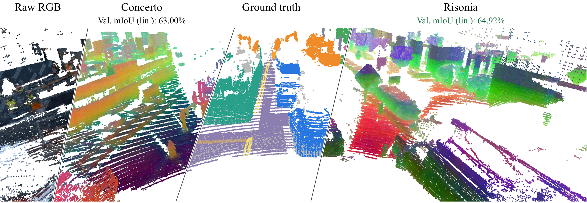
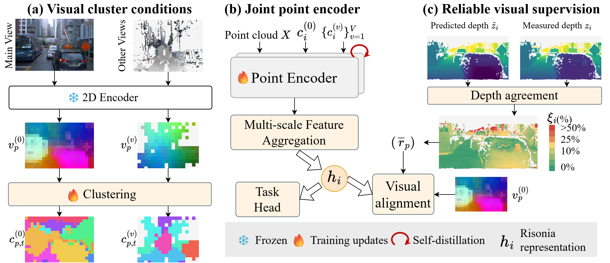
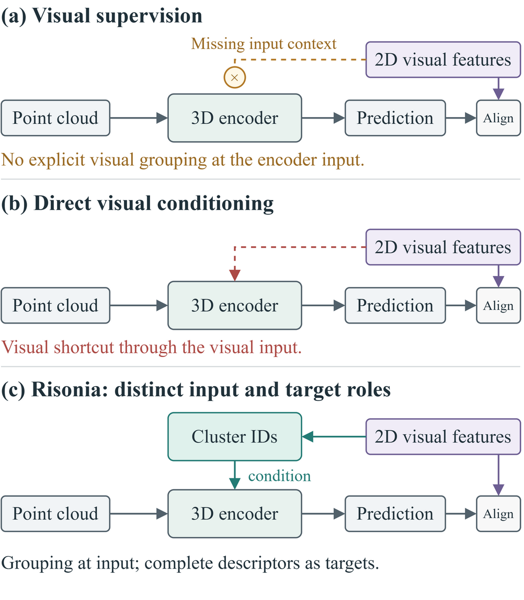
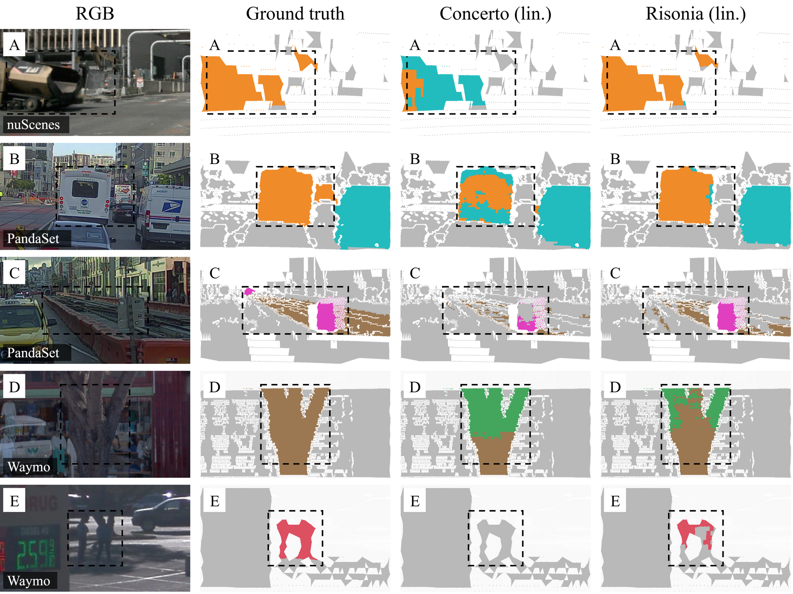
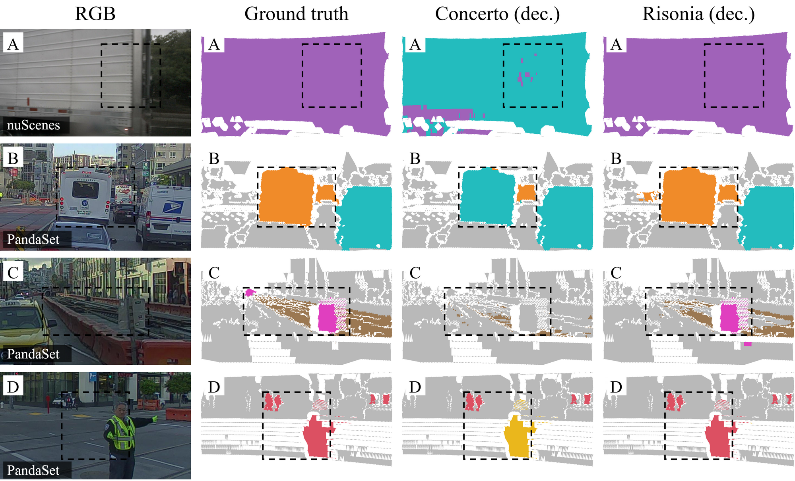
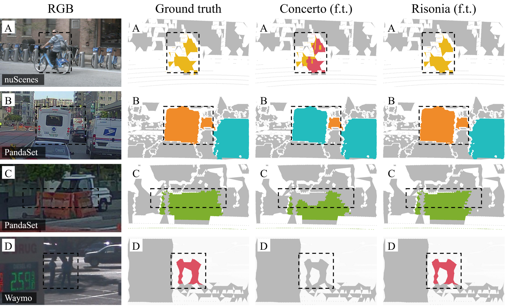

# Risonia

**Risonia: Visual Cluster Conditioning and Reliability-Weighted Supervision for 3D Self-Supervised Learning**

**Bole Zhang, Ce Zhang, and Nantheera Anantrasirichai**


[Overview](#overview) · [Method](#method) · [Results](#results) · [Release status](#release-status) · [Citation](#citation)

> **Project status:** This work is being prepared for submission to **CVPR 2027**. This initial public repository contains the project description, figures, and results from the current manuscript. Training code, configurations, and pretrained checkpoints are being prepared for release.

## Overview

**Risonia conditions a 3D point encoder on visual cluster IDs while retaining complete visual descriptors as self-supervised prediction targets.**

Directly supplying the same visual descriptors as both inputs and targets can provide a shortcut for reproducing image features. Risonia instead supplies shared cluster-membership conditions: distinct descriptors can share one ID, so the condition omits continuous within-cluster variation. The point encoder combines these grouping cues with point attributes and geometric neighborhood context.

Three components support this design:

1. **Visual cluster-ID conditioning:** shared visual grouping cues enter the point encoder; complete descriptors remain prediction targets.
2. **Weak multi-view grouping:** complementary rendered point-cloud views extend the available grouping conditions beyond original-camera visibility.
3. **Reliability-weighted supervision:** agreement between image-predicted depth and measured point depth weights visual alignment.

Risonia is evaluated on **nuScenes, PandaSet, and Waymo** through linear probing, frozen-encoder decoder adaptation, and full fine-tuning, with an additional nuScenes panoptic evaluation.



*A continuous Waymo panorama with raw RGB, Concerto feature PCA, ground-truth semantic labels, and Risonia feature PCA. The PCA colors use matched five-epoch visualization encoders and are fitted separately for each method; they are not shared semantic labels. The scores above the methods are the main-table Waymo linear-probing results.*

## Method



A frozen **DINOv3 ViT-L/16** encoder provides visual patch descriptors. Original-camera descriptors supply the complete prediction targets; camera and rendered-view cluster IDs supply the input conditions. Cluster centers and assignment frequencies are updated online using exponential moving averages and are frozen for validation and downstream adaptation.

The point encoder receives **XYZ, camera-projected RGB, surface normals, and visual cluster conditions**. Cluster conditions are retained during downstream use. Depth prediction and reliability calibration are used only during pretraining.

Rendered views use depth-buffered point splats on a fixed background. Clustering and point-condition association use valid projected-point support; sparse rendered descriptors provide bounded auxiliary conditions rather than visual prediction targets.

<details>
<summary>Why separate visual input and supervision?</summary>



Cluster assignment is a many-to-one mapping. Different descriptors can receive the same main cluster condition, so that condition alone cannot distinguish their within-cluster differences. This limits direct descriptor copying while retaining useful visual grouping. It encourages the encoder to use additional point attributes and neighborhood context; it does not by itself guarantee geometric understanding.

</details>

See [method details and reported configuration](docs/METHOD.md).

## Results

The tables below report the **current manuscript's validation results**. mIoU values are percentages. Pretraining and adaptation are performed separately on each dataset's training split.

### Semantic segmentation

| Protocol | Method | nuScenes | PandaSet | Waymo |
| :-- | :-- | --: | --: | --: |
| Linear probing | Sonata | 66.10 | 47.98 | 60.50 |
| Linear probing | Concerto | 75.20 | 63.64 | 63.00 |
| Linear probing | Utonia | 75.50 | 70.60 | 63.80 |
| Linear probing | Risonia | **76.92** | **72.08** | **64.92** |
| Frozen-encoder decoder | Sonata | 77.30 | 65.93 | 69.10 |
| Frozen-encoder decoder | Concerto | 78.00 | 71.27 | 69.20 |
| Frozen-encoder decoder | Utonia | 78.20 | 71.82 | **69.40** |
| Frozen-encoder decoder | Risonia | **82.54** | **76.21** | 69.30 |
| Full fine-tuning | Sonata | 81.70 | 74.55 | **72.90** |
| Full fine-tuning | Concerto | 81.80 | 79.51 | 69.80 |
| Full fine-tuning | Utonia | 82.20 | 79.12 | 71.40 |
| Full fine-tuning | Risonia | **82.74** | **80.41** | **72.90** |

Best mIoU values within each protocol and dataset are bold, including ties. PTv3 is a separate supervised reference: **80.40 / 60.15 / 71.30 mIoU** on nuScenes / PandaSet / Waymo.

**Comparison protocol.** Concerto is reproduced with the same frozen DINOv3 visual encoder as Risonia. Utonia is evaluated from its official pretrained checkpoint with downstream readouts retrained under the comparison protocols. Compared point encoders share XYZ, camera-projected RGB, and normals; Risonia additionally receives cluster conditions. These are our manuscript's evaluations, rather than a collection of author-reported scores.

**Improvements over Concerto.** Absolute gains below are **mIoU percentage points**. Relative gains are computed from the mean mIoU across the three datasets.

| Protocol | nuScenes | PandaSet | Waymo | Mean gain | Relative gain in mean mIoU |
| :-- | --: | --: | --: | --: | --: |
| Linear probing | +1.72 | +8.44 | +1.92 | +4.03 | +5.98% |
| Frozen-encoder decoder | +4.54 | +4.94 | +0.10 | +3.19 | +4.39% |
| Full fine-tuning | +0.94 | +0.90 | +3.10 | +1.65 | +2.14% |

The machine-readable [semantic results](results/semantic_segmentation.csv) also include mAcc and overall accuracy.

### Panoptic segmentation on nuScenes

| Method | PQ | SQ | RQ | PQ things | PQ stuff |
| :-- | --: | --: | --: | --: | --: |
| Sonata | 41.72 | 77.62 | 51.42 | 35.43 | 52.20 |
| Concerto | 54.31 | 82.31 | 64.87 | 48.97 | 63.21 |
| **Risonia** | **62.33** | **83.51** | **73.74** | **58.37** | **68.93** |

Risonia improves PQ over Concerto by **8.02 percentage points**, or **14.77% relative**. Its semantic mIoU in this panoptic evaluation is **70.08**. All methods use frozen encoders, the same semantic and center-offset head, the same grouping procedure, and 50 downstream epochs on all 6,019 validation frames with 10-view test-time augmentation.

[Panoptic results CSV](results/panoptic_segmentation.csv)

### Component ablations on PandaSet

| Reliability | Rendered-view conditions | Original-camera conditions | Linear mIoU | Decoder mIoU |
| :--: | :--: | :--: | --: | --: |
| No | Yes | Yes | 69.96 | 74.27 |
| Yes | No | Yes | 70.05 | 75.46 |
| Yes | Yes | No | 67.46 | 72.58 |
| **Yes** | **Yes** | **Yes** | **72.08** | **76.21** |

All ablations use 50 downstream epochs and four-view test-time augmentation on 560 validation frames. [Ablation results CSV](results/pandaset_ablation.csv).

### Qualitative results

<details>
<summary>Linear probing: frozen point encoder and linear classifier</summary>



</details>

<details>
<summary>Decoder adaptation: both point encoders are frozen</summary>



</details>

<details>
<summary>Full fine-tuning: both complete models are adapted</summary>



</details>

## Datasets and evaluation protocols

| Dataset | Validation classes | Validation frames | Evaluation |
| :-- | --: | --: | :-- |
| nuScenes | 16 | 6,019 | Semantic and panoptic segmentation |
| PandaSet | 14 | 560 | Semantic segmentation; mechanical LiDAR |
| Waymo | 22 | 5,976 | Semantic segmentation |

- **Linear probing:** freeze the point encoder and train a linear semantic classifier.
- **Frozen-encoder decoder adaptation:** freeze the point encoder and train the decoder readout.
- **Full fine-tuning:** update the encoder and task readout together.

The original datasets and third-party pretrained models must be obtained from their respective providers. Dataset preparation and exact execution commands will accompany the implementation release.

## Release status

- [x] Public project description and method overview
- [x] Manuscript result tables in CSV format
- [x] Motivation, overview, and qualitative figures
- [ ] Public paper / preprint link
- [ ] Portable training and inference implementation
- [ ] Dataset preprocessing and feature preparation tools
- [ ] Pinned environment files and experiment configurations
- [ ] Pretrained checkpoints and model cards
- [ ] End-to-end reproduction instructions

This is currently a **project preview**. Runnable training/inference code and downloadable model weights are not yet included. See [release details](docs/RELEASE.md) for the current scope.

## Citation

The manuscript is in preparation. The following provisional citation can be used for this project; it will be updated when the paper becomes publicly available.

```bibtex
@unpublished{zhang2026risonia,
  title  = {Risonia: Visual Cluster Conditioning and Reliability-Weighted Supervision for 3D Self-Supervised Learning},
  author = {Bole Zhang and Ce Zhang and Nantheera Anantrasirichai},
  year   = {2026},
  note   = {Manuscript in preparation for CVPR 2027},
  url    = {https://github.com/zbole/Risonia}
}
```

## Acknowledgments

This work builds on and compares with [Pointcept](https://github.com/Pointcept/Pointcept), [Sonata](https://github.com/facebookresearch/sonata), [Concerto](https://github.com/Pointcept/Concerto), and [Utonia](https://github.com/Pointcept/Utonia). Visual and depth supervision use [DINOv3](https://github.com/facebookresearch/dinov3) and [Depth Anything 3](https://github.com/ByteDance-Seed/Depth-Anything-3).

We thank the providers of [nuScenes](https://www.nuscenes.org/nuscenes), [PandaSet](https://github.com/scaleapi/pandaset-devkit), and the [Waymo Open Dataset](https://waymo.com/open/).

## Contact

Please use [GitHub Issues](https://github.com/zbole/Risonia/issues) for questions about the project and release progress.
